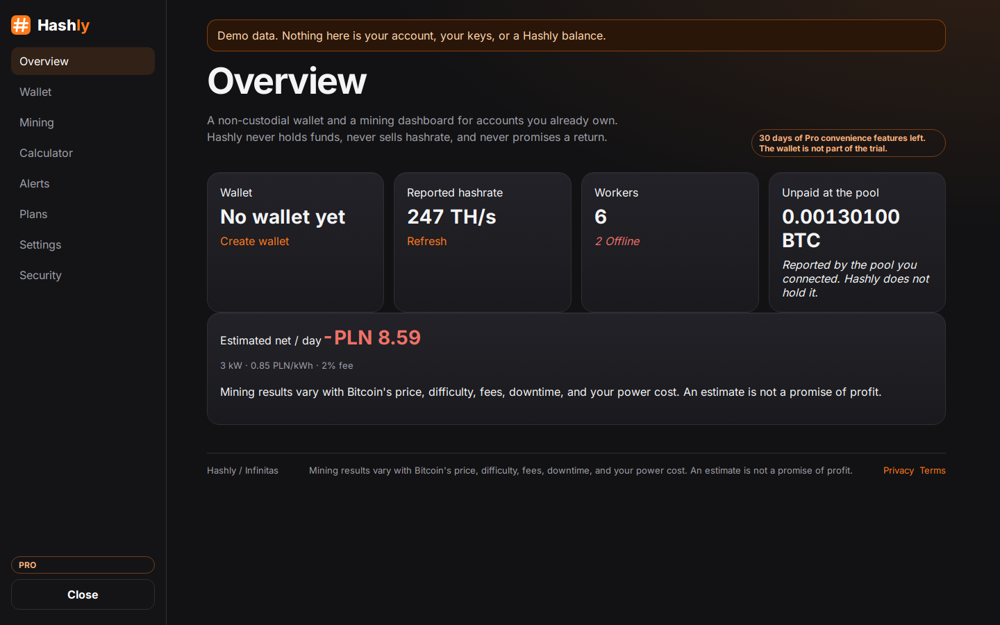
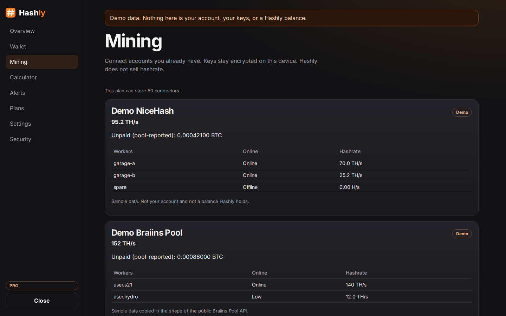
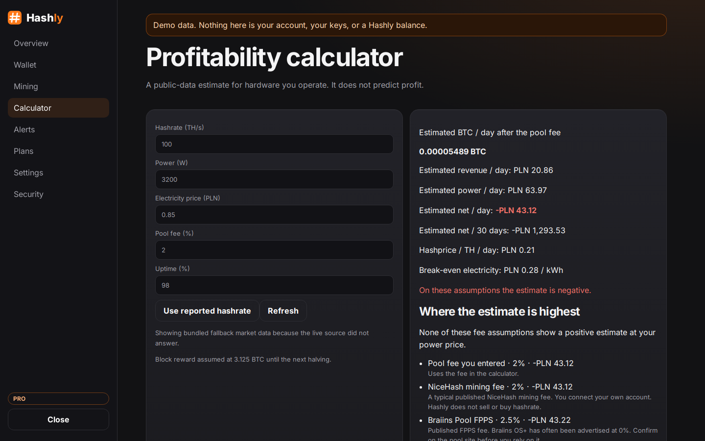
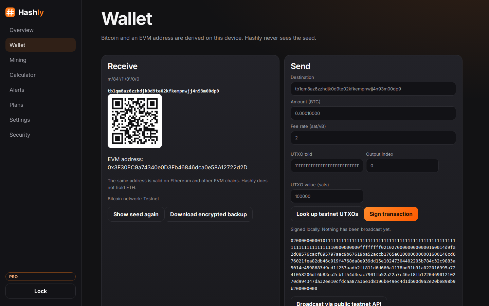
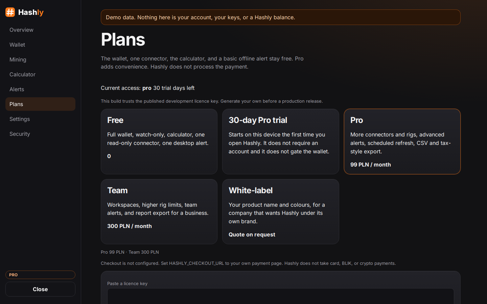

# Hashly

**Your keys. Your miners. Your machine.**

Hashly is a non-custodial wallet and a mining dashboard for accounts you already own. It runs on your computer. It does not hold funds, it does not sell hashrate, and it does not promise a return.

[Polski](README.pl.md) · [Security](SECURITY.md) · [Contributing](CONTRIBUTING.md)



Mining results move with Bitcoin's price, difficulty, fees, downtime, and your power cost. A number in this app is an estimate, not a forecast and not an offer.

Published by **Hashly / Infinitas**.

## What it is

| | |
| --- | --- |
| Wallet | Bitcoin native SegWit (BIP84) and an EVM address. The seed is created on this device, checked with a 3-word backup quiz, and stored only as Argon2id + AES-GCM ciphertext. |
| Watch-only | An address or an account zpub/vpub. No signing. |
| Mining | Read-only connectors for **your** NiceHash organisation, **your** Braiins Pool access token, and a Braiins OS / CGMiner API on your LAN. |
| Calculator | Live BTC price and difficulty, your hashrate, your watts, your electricity price in PLN, USD, or EUR. It will say when the estimate is negative. |
| Plans | The wallet stays free. A 30-day Pro trial, then Pro at 99 PLN/month or Team at 300 PLN/month. White-label is a quote. |
| Languages | Polish, English, German, Russian, Spanish. |

There is no account, no telemetry, and no card, BLIK, or crypto payment code. Checkout is a link you configure.

## Screens









The mining and overview shots above are **demo data**. The wallet shot is a real testnet key generated in the app. Do not send mainnet coins to a screenshot.

## Quick start

Node.js 22.

```bash
npm ci
npm test
npm run build
npm start
```

Open http://127.0.0.1:8787. The first screen asks for a local passphrase. **Hashly cannot reset it.** Lose it and the ciphertext on that device stays unreadable.

Two processes during development:

```bash
npm run dev       # API on 127.0.0.1:8787
npm run dev:web   # UI on 127.0.0.1:5173
```

Demo mode needs no passphrase and invents the miners. It does not create a seed and it does not call a pool.

### Desktop

Windows is the first installer target. The GitHub release workflow builds an NSIS installer on `v*` tags. It is not code-signed yet.

```bash
npm run build
HASHLY_DEV_URL=http://127.0.0.1:5173 npm run dev -w @hashly/desktop
```

A local Tor client can be set in Settings as `socks5://127.0.0.1:9050`. The browser build does not tunnel by itself. Use Tor Browser if that is the route you want there.

### Docker

```bash
docker compose up --build
```

The container listens on port 8080. Do not publish it on the open internet without a firewall. The connector routes will relay a pool call for whoever can reach them, using the token that caller sends.

## How the wallet works

1. You set a passphrase. Argon2id (19 MiB, 2 iterations) stretches it. AES-256-GCM encrypts the vault.
2. A new wallet shows 12 English BIP39 words. You confirm three of them. The words are English because BIP39 says so, whatever language the UI is in.
3. Bitcoin receive addresses are native SegWit. New wallets default to **testnet**.
4. Send builds a P2WPKH transaction, signs it locally, and stops. Broadcast is a separate button and only after you confirm.
5. The EVM screen can sign an EIP-191 message. It does not send Ethereum transactions in this version.

Libraries: `@scure/bip39`, `@scure/bip32`, `bitcoinjs-lib`, `@bitcoinerlab/secp256k1`, `@noble/curves`, `@noble/ciphers`, `@noble/hashes`. Hashly does not invent a cipher. This release has not had an independent audit. Read [SECURITY.md](SECURITY.md) and [docs/threat-model.md](docs/threat-model.md) before a mainnet seed holds money you care about.

## Connectors

You paste a **read-only** credential. It is encrypted with the same passphrase and sent only when you refresh.

- **NiceHash** — organisation id, API key, API secret. Create the key with permission to view mining statistics. Hashly signs the request the way NiceHash documents, and it will not call an order endpoint.
- **Braiins Pool** — the access-profile token (`Pool-Auth-Token`). Workers, hashrate, and the pool's own reward figure. Braiins does not offer a stable API for buying hashpower, so this connector does not sell it either.
- **Own rig** — Braiins OS or CGMiner on port 4028. Private addresses only. The allowed commands are `summary`, `devs`, `pools`, `version`, and `coin`. `restart` and `addpool` are rejected in code.

Unpaid amounts are the pool's number. They are not a Hashly balance.

Add another pool by following [docs/connectors.md](docs/connectors.md).

## Plans and licences

| Plan | Price | You get |
| --- | --- | --- |
| Free | 0 | Full wallet, watch-only, calculator, one connector, one desktop offline alert |
| Trial | 30 days on this device | Pro features. No account. The wallet is not part of the trial |
| Pro | 99 PLN / month | More connectors and rigs, Telegram and webhook alerts, a refresh schedule, CSV export |
| Team | 300 PLN / month | More workspaces and rigs, team alerts, report export |
| White-label | Quote | Your product name and colours. [docs/white-label.md](docs/white-label.md) |

The core is [MIT](LICENSE). Pro modules are source-available under the [Hashly Commercial License](LICENSE-PRO.md). Personal non-commercial use of that source is allowed. A company running Team or white-label needs a key.

Official builds check an Ed25519 signature offline. A fork can delete the check. That is why the wallet is not behind it.

### Issuing a key

Development builds trust a **published** key so anyone can try the gate. It is in `dev-keys/` and must not be the key you ship.

```bash
npm run license -- keygen --out .hashly/license-private.hex
# prints HASHLY_LICENSE_PUBLIC_KEY=...  (keep the private file off git)

VITE_HASHLY_LICENSE_PUBLIC_KEY=<that public key> npm run build

npm run license -- issue \
  --private-key .hashly/license-private.hex \
  --plan pro \
  --subject miner@example.com \
  --days 31
```

Plans are `pro`, `team`, and `whitelabel`. The customer pastes the token into Plans. Hashly does not phone home.

To take payment, set `VITE_HASHLY_CHECKOUT_URL` to a page you operate. This repository does not charge cards, BLIK, or crypto.

Details: [docs/licensing.md](docs/licensing.md).

## Compared with the usual alternatives

| | Hashly | A custodial cloud-mining site | One pool's website |
| --- | --- | --- | --- |
| Who holds the seed | You, on this device | Often the site, or there is no wallet | Not a wallet |
| Sells hashrate to you | No | That is the product | Sometimes |
| Shows hashrate you already own | Yes, from APIs you connect | No | That pool only |
| Can promise a return | The UI is written not to | Many do | Usually not |
| Source you can read | Yes | Rarely | Rarely |
| Account required | No | Yes | Yes, at the pool |

## Roadmap

- More read-only connectors (F2Pool, ViaBTC, and others the SDK makes easy)
- Hardware-wallet signing, still without Hashly taking the seed
- A clearer mainnet send flow, and PSBT export
- Code signing for the Windows installer
- An independent review of the wallet path
- Mobile as a watch-only companion, not a second place the seed lives

## FAQ

**Does Hashly hold my bitcoin?**
No. The seed never leaves the device, and there is no deposit address that belongs to Hashly.

**Is the mining real?**
The dashboard is real when you connect a real pool or a real rig. Demo mode is labelled and invented. Hashly itself does not operate miners and does not sell hashrate.

**Will I profit?**
Nobody honest can tell you that. The calculator is there so you can see power cost next to a public estimate, including when the estimate is negative.

**What if I lose the passphrase?**
There is no reset. That is the cost of a local vault. Write the seed on paper as well. The encrypted backup file is useless without the passphrase.

**Why are the seed words in English?**
BIP39 defines them that way. The rest of the app follows the language you pick.

**Is the trial a server account?**
No. The clock is on the device. Rolling the clock backward does not extend it. Clearing site data starts over, which we say plainly because it is local software.

**Can I add my company's name?**
Yes, with a white-label licence. The security rules do not change.

## Legal

[Privacy](docs/legal/PRIVACY.md) and [terms](docs/legal/TERMS.md) are drafts for a lawyer. They are marked that way in the app too.

## Licence

MIT for the core. [LICENSE-PRO.md](LICENSE-PRO.md) for `packages/pro`.

Version 0.1.0. See [CHANGELOG.md](CHANGELOG.md).
