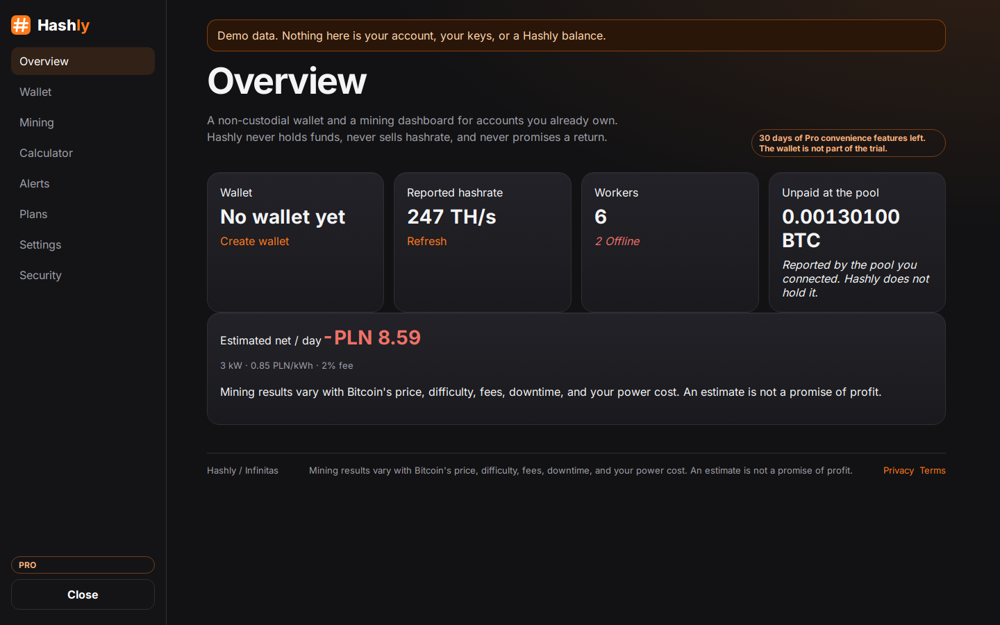
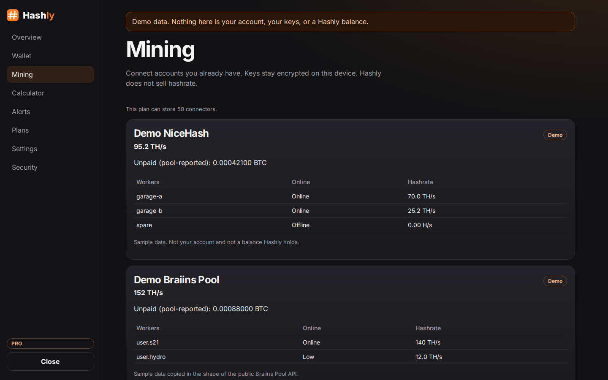
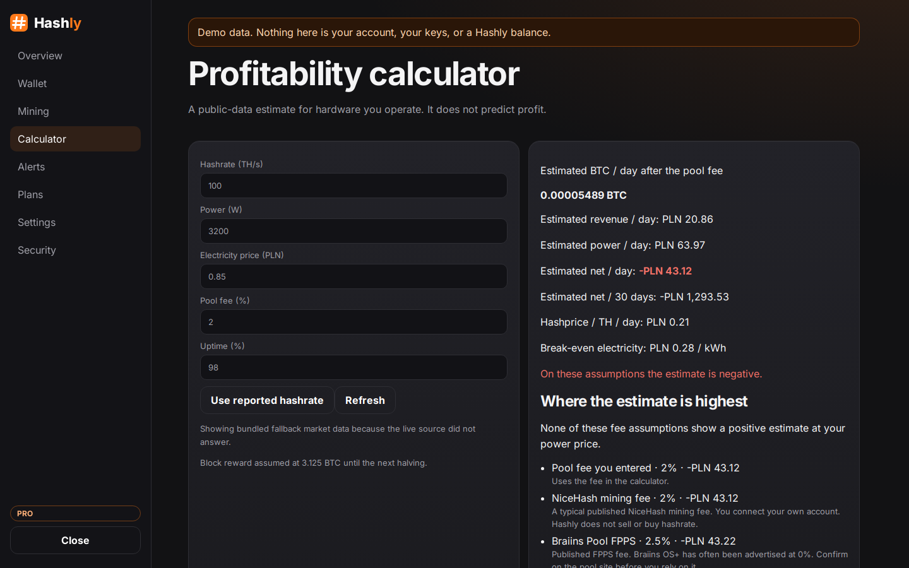
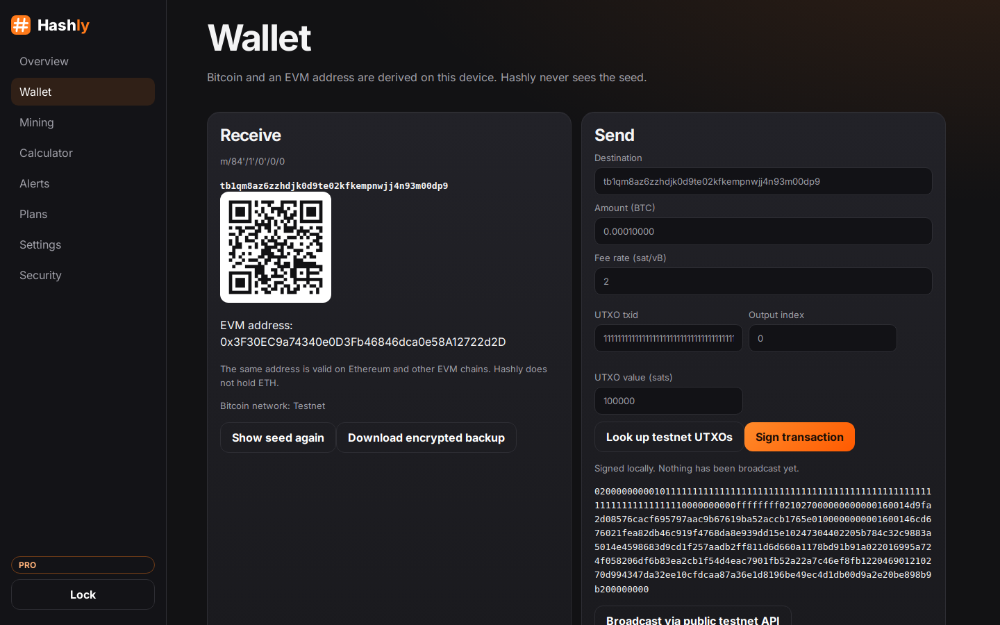
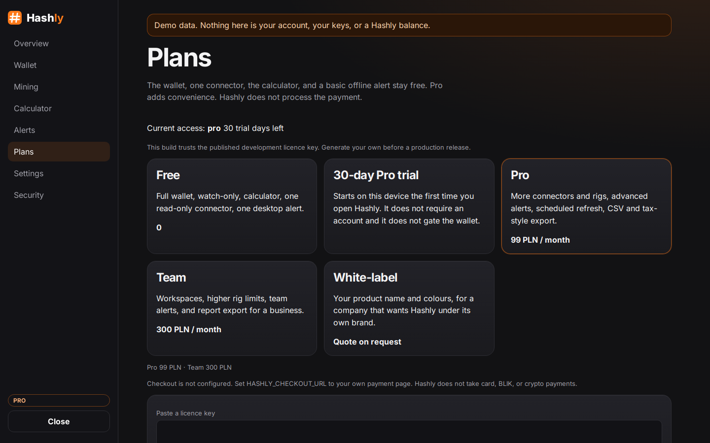

# Hashly

**Twoje klucze. Twoje koparki. Twój komputer.**

Hashly to portfel bez powiernika i panel wydobycia do kont, które już masz. Działa na Twoim komputerze. Nie trzyma środków, nie sprzedaje mocy i nie obiecuje zwrotu.

[English](README.md) · [Bezpieczeństwo](SECURITY.md) · [Współtworzenie](CONTRIBUTING.md)



Wynik kopania zmienia się wraz z ceną Bitcoina, trudnością, opłatami, przestojami i ceną prądu. Liczba w tej aplikacji to szacunek, nie prognoza i nie oferta.

Wydawca: **Hashly / Infinitas**.

## Co to jest

| | |
| --- | --- |
| Portfel | Bitcoin native SegWit (BIP84) i adres EVM. Fraza powstaje na tym urządzeniu, sprawdzasz trzy słowa kopii, a na dysku zostaje tylko szyfrogram Argon2id + AES-GCM. |
| Podgląd | Adres albo zpub/vpub konta. Bez podpisu. |
| Wydobycie | Konektory tylko do odczytu: **Twoja** organizacja NiceHash, **Twój** token Braiins Pool i API Braiins OS / CGMiner w Twojej sieci LAN. |
| Kalkulator | Cena BTC i trudność z publicznych źródeł, Twoja moc, waty i cena prądu w PLN, USD albo EUR. Gdy szacunek jest ujemny, aplikacja tak pisze. |
| Plany | Portfel zostaje darmowy. 30 dni Pro, potem Pro 99 PLN/miesiąc albo Team 300 PLN/miesiąc. White-label na wycenę. |
| Języki | Polski, angielski, niemiecki, rosyjski, hiszpański. |

Nie ma konta, nie ma telemetrii i nie ma kodu płatności kartą, BLIK-iem ani krypto. Kasa to odnośnik, który sam ustawiasz.

## Ekrany









Ujęcia przeglądu i wydobycia to **dane demo**. Ujęcie portfela to prawdziwy klucz testnet utworzony w aplikacji. Nie wysyłaj środków mainnet na adres ze zrzutu.

## Start

Node.js 22.

```bash
npm ci
npm test
npm run build
npm start
```

Otwórz http://127.0.0.1:8787. Pierwszy ekran prosi o lokalne hasło. **Hashly go nie odtworzy.** Bez niego szyfrogram na tym urządzeniu zostaje nieczytelny.

W czasie pracy nad kodem:

```bash
npm run dev       # API na 127.0.0.1:8787
npm run dev:web   # interfejs na 127.0.0.1:5173
```

Demo nie wymaga hasła. Wymyśla koparki, nie tworzy frazy i nie dzwoni do puli.

### Aplikacja desktop

Pierwszy instalator jest pod Windows. Workflow wydania na tagu `v*` buduje instalator NSIS. Nie jest jeszcze podpisany cyfrowo.

```bash
npm run build
HASHLY_DEV_URL=http://127.0.0.1:5173 npm run dev -w @hashly/desktop
```

Lokalnego Tora wpiszesz w ustawieniach jako `socks5://127.0.0.1:9050`. Wersja w przeglądarce sama nie tuneluje ruchu. Do tego służy Tor Browser.

### Docker

```bash
docker compose up --build
```

Kontener słucha na porcie 8080. Nie wystawiaj go w otwarty internet bez zapory. Trasy konektorów przekażą zapytanie do puli temu, kto do nich dosięgnie, tokenem, który sam wyśle.

## Jak działa portfel

1. Ustawiasz hasło. Argon2id (19 MiB, 2 iteracje) je rozciąga. AES-256-GCM szyfruje sejf.
2. Nowy portfel pokazuje 12 angielskich słów BIP39. Potwierdzasz trzy. Słowa są po angielsku, bo tak stanowi BIP39, niezależnie od języka interfejsu.
3. Adresy odbioru to native SegWit. Nowe portfele startują w **testnecie**.
4. Wysłanie składa transakcję P2WPKH, podpisuje ją lokalnie i staje. Rozgłoszenie to osobny przycisk, dopiero po potwierdzeniu.
5. Ekran EVM podpisuje wiadomość EIP-191. W tej wersji nie wysyła transakcji Ethereum.

Biblioteki: `@scure/bip39`, `@scure/bip32`, `bitcoinjs-lib`, `@bitcoinerlab/secp256k1`, `@noble/curves`, `@noble/ciphers`, `@noble/hashes`. Hashly nie wymyśla szyfru. To wydanie nie miało niezależnego audytu. Zanim fraza mainnet będzie trzymać pieniądze, na których Ci zależy, przeczytaj [SECURITY.md](SECURITY.md) i [docs/threat-model.md](docs/threat-model.md).

## Konektory

Wklejasz dane **tylko do odczytu**. Są szyfrowane tym samym hasłem i wychodzą z urządzenia dopiero przy odświeżeniu.

- **NiceHash** — id organizacji, klucz API, sekret API. Nadaj kluczowi uprawnienie podglądu statystyk. Hashly podpisuje żądanie tak, jak opisuje NiceHash, i nie woła endpointu zleceń.
- **Braiins Pool** — token profilu dostępu (`Pool-Auth-Token`). Workery, moc i kwota, którą podaje pula. Braiins nie ma stabilnego API do kupowania mocy, więc ten konektor też jej nie sprzedaje.
- **Własna koparka** — Braiins OS albo CGMiner, port 4028. Tylko adresy prywatne. Dozwolone polecenia to `summary`, `devs`, `pools`, `version` i `coin`. `restart` i `addpool` są w kodzie odrzucane.

Kwota niewypłacona jest liczbą puli. To nie jest saldo Hashly.

Kolejną pulę dodasz według [docs/connectors.md](docs/connectors.md).

## Plany i licencje

| Plan | Cena | Co daje |
| --- | --- | --- |
| Free | 0 | Pełny portfel, podgląd, kalkulator, jeden konektor, jeden alert pulpitu |
| Próba | 30 dni na tym urządzeniu | Funkcje Pro. Bez konta. Portfel nie jest częścią próby |
| Pro | 99 PLN / miesiąc | Więcej konektorów i koparek, alerty Telegram i webhook, harmonogram, eksport CSV |
| Team | 300 PLN / miesiąc | Więcej obszarów i koparek, alerty zespołu, eksport raportu |
| White-label | Wycena | Twoja nazwa i kolory. [docs/white-label.md](docs/white-label.md) |

Rdzeń jest na [MIT](LICENSE). Moduły Pro są dostępne źródłowo na [licencji komercyjnej Hashly](LICENSE-PRO.md). Osobiste, niekomercyjne użycie tego kodu jest dozwolone. Firma na planie Team albo white-label potrzebuje klucza.

Oficjalna kompilacja sprawdza podpis Ed25519 offline. Fork może sprawdzenie wyciąć. Dlatego portfel nie stoi za nim.

### Wystawianie klucza

Kompilacje deweloperskie ufają **opublikowanemu** kluczowi, żeby dało się bramkę sprawdzić. Leży w `dev-keys/` i nie może być kluczem, który wydajesz klientom.

```bash
npm run license -- keygen --out .hashly/license-private.hex
# wypisuje HASHLY_LICENSE_PUBLIC_KEY=...  (prywatny plik zostaje poza gitem)

VITE_HASHLY_LICENSE_PUBLIC_KEY=<ten klucz publiczny> npm run build

npm run license -- issue \
  --private-key .hashly/license-private.hex \
  --plan pro \
  --subject miner@example.com \
  --days 31
```

Plany to `pro`, `team` i `whitelabel`. Klient wkleja token w Plany. Hashly nie dzwoni do serwera, żeby go potwierdzić.

Żeby przyjmować płatność, ustaw `VITE_HASHLY_CHECKOUT_URL` na stronę, którą sam prowadzisz. To repozytorium nie pobiera karty, BLIK-a ani krypto.

Szczegóły: [docs/licensing.md](docs/licensing.md).

## Porównanie

| | Hashly | Serwis kopania w chmurze z powiernikiem | Strona jednej puli |
| --- | --- | --- | --- |
| Kto ma frazę | Ty, na tym urządzeniu | Często serwis, albo portfela nie ma | To nie jest portfel |
| Sprzedaje Ci moc | Nie | To jest produkt | Czasem |
| Pokazuje moc, którą już masz | Tak, z API, które podłączysz | Nie | Tylko ta pula |
| Może obiecać zwrot | Interfejs jest napisany tak, żeby tego nie robił | Wiele obiecuje | Zwykle nie |
| Kod do czytania | Tak | Rzadko | Rzadko |
| Konto | Nie | Tak | Tak, na puli |

## Dalsza droga

- Kolejne konektory tylko do odczytu (F2Pool, ViaBTC i inne, które SDK ułatwia)
- Podpis portfelem sprzętowym, nadal bez oddawania frazy Hashly
- Czytelniejszy wysył mainnet i eksport PSBT
- Podpis cyfrowy instalatora Windows
- Niezależny przegląd ścieżki portfela
- Telefon tylko jako podgląd, nie jako drugie miejsce frazy

## Pytania

**Czy Hashly trzyma mojego bitcoina?**
Nie. Fraza nie opuszcza urządzenia i nie ma adresu wpłaty, który należałby do Hashly.

**Czy wydobycie jest prawdziwe?**
Panel jest prawdziwy, gdy podłączysz prawdziwą pulę albo prawdziwą koparkę. Demo jest podpisane i wymyślone. Hashly sam nie prowadzi koparek i nie sprzedaje mocy.

**Czy zarobię?**
Tego uczciwie nie da się obiecać. Kalkulator jest po to, żeby obok publicznego szacunku zobaczyć koszt prądu, także gdy szacunek jest ujemny.

**Co jeśli zgubię hasło?**
Nie ma resetu. Taki jest koszt lokalnego sejfu. Frazę zapisz na papierze. Plik zaszyfrowanej kopii bez hasła nic nie daje.

**Czemu słowa frazy są po angielsku?**
Tak definiuje je BIP39. Reszta aplikacji idzie za językiem, który wybierzesz.

**Czy okres próbny to konto na serwerze?**
Nie. Zegar jest na urządzeniu. Cofnięcie zegara go nie przedłuża. Wyczyszczenie danych strony zaczyna od nowa. Mówimy to wprost, bo to lokalny program.

**Czy mogę wstawić nazwę swojej firmy?**
Tak, z licencją white-label. Zasady bezpieczeństwa się nie zmieniają.

## Prawo

[Prywatność](docs/legal/PRIVACY.md) i [regulamin](docs/legal/TERMS.md) to szkice dla prawnika. W aplikacji też są tak oznaczone.

## Licencja

MIT dla rdzenia. [LICENSE-PRO.md](LICENSE-PRO.md) dla `packages/pro`.

Wersja 0.1.0. Zobacz [CHANGELOG.md](CHANGELOG.md).
